# Maze Solver using A* Search


**Syntecxhub AI Internship — Week 1, Project 1**

A dependency-free Python package that finds the shortest path through a grid maze with **A\* search**, compares it against four other search algorithms, generates random mazes, and produces **animated SVG visualisations** that replay the search step by step.

<p align="center">
  
</p>

## Project requirements

| Requirement | Where it is implemented |
|---|---|
| Represent a maze/grid (start, goal, walls) and model it as nodes | `astar_maze/grid.py` — `Maze` class; open cells are nodes, legal moves are weighted edges (`Maze.neighbors`) |
| Implement A* with a heuristic (Manhattan or Euclidean) | `astar_maze/search.py` — priority-queue A*; `astar_maze/heuristics.py` — Manhattan, Euclidean, octile, Chebyshev |
| Return the shortest path and handle unreachable cases | `solve()` returns a `SearchResult` with `path`, `cost`, `steps`; `path is None` when the goal is unreachable |
| Visualise the search and final path (console or plot) | `astar_maze/visualize.py` — coloured console view, static SVG and animated SVG |

## Features

- **A\*** with lazy-deletion priority queue and goal-directed tie-breaking.
- **Five algorithms** behind one API: A\*, weighted A\*, Dijkstra, greedy best-first, breadth-first search.
- **Five heuristics** with an admissibility check (a warning is raised if the heuristic can overestimate).
- **4-way or 8-way movement**. Diagonal moves cost √2 and cannot cut wall corners.
- **Maze generator**: recursive backtracker with a seed for reproducibility, plus *braiding* to add loops, or random obstacle fields.
- **JSON and text maze formats**: write mazes by hand with `#`, `.`, `S`, `G`.
- **Search statistics**: nodes expanded, peak frontier size, path cost, runtime.
- **Visualisation**: ANSI-coloured terminal output, static SVG, and animated SVG (plays in any browser and on GitHub).
- **31 unit tests** including randomised cross-checks against BFS and Dijkstra; CI on Python 3.9–3.13.
- No third-party packages.

## Quick start

Requires Python 3.9 or newer.

```bash
git clone https://github.com/yasmeenmh90-beep/Syntecxhub_Maze_Solver.git
cd Syntecxhub_Maze_Solver

python3 maze_solver.py                                    # solve the built-in 5x5 demo
python3 maze_solver.py --maze examples/maze.json --svg output/solution.svg
python3 maze_solver.py --maze examples/rescue_maze.json --svg output/rescue.svg --animate
python3 maze_solver.py --maze examples/unreachable.json   # reports "No path found"
```

Example output:

```text
Maze: 5x5, 17 open cells, start [0, 0] -> goal [4, 4]
Algorithm: A* (heuristic: manhattan, 4-way movement)
Shortest path: 8 moves
Coordinates: [(0, 0), (0, 1), (1, 1), (2, 1), (2, 2), (2, 3), (2, 4), (3, 4), (4, 4)]
Expanded cells: 9 | peak frontier: 3 | time: 0.05 ms

S * # - -
# * # - #
- * * * *
- # # # *
- - - # G
```

Optional: `pip install .` installs an `astar-maze` command that works the same as `python3 maze_solver.py`.

## Usage

The CLI has three commands. If no command is given, `solve` is used.

### `solve` — solve one maze

```bash
# Animated visualisation of a generated maze
python3 maze_solver.py solve --maze examples/generated_12x20.json --svg output/astar.svg --animate

# 8-way movement on a hand-written text maze
python3 maze_solver.py solve --maze examples/open_room.txt --diagonal

# Choose the algorithm / heuristic, or get JSON output
python3 maze_solver.py solve --random 20 20 --seed 3 --algorithm dijkstra
python3 maze_solver.py solve --heuristic euclidean --json
```

| Option | Description |
|---|---|
| `--maze FILE` | `.json` or `.txt` maze (default: built-in demo) |
| `--random ROWS COLS` | generate a maze instead (`--seed`, `--braid` apply) |
| `--algorithm` | `astar` (default), `weighted`, `dijkstra`, `greedy`, `bfs` |
| `--heuristic` | `manhattan`, `euclidean`, `octile`, `chebyshev`, `zero` |
| `--diagonal` | allow 8-direction movement |
| `--weight W` | heuristic weight for weighted A* (default 2) |
| `--svg OUT` / `--animate` | save a static or animated SVG |
| `--json` | machine-readable result |

### `compare` — benchmark every algorithm on one maze

```bash
python3 maze_solver.py compare --maze examples/obstacles_25x25.txt --svg-dir output/compare
```

### `generate` — create maze files

```bash
python3 maze_solver.py generate --rows 15 --cols 25 --seed 42 --braid 0.3 --out my_maze.json
python3 maze_solver.py generate --rows 30 --cols 30 --obstacles 0.3 --seed 1 --out field.txt
```

### Python API

```python
from astar_maze import Maze, solve, generate_maze

maze = Maze.from_text("""
S..#....
.#.#.##.
.#...#.G
""")
result = solve(maze, algorithm="astar", heuristic="manhattan")
print(result.found, result.steps, result.cost, result.nodes_expanded)
print(result.path)          # list of (row, col) or None if unreachable
```

## Maze formats

**JSON** — `0` is open, `1` is a wall, coordinates are `[row, column]` from the top-left:

```json
{"grid": [[0,0,1],[1,0,1],[1,0,0]], "start": [0,0], "goal": [2,2]}
```

**Text** — one character per cell:

```text
S..#
.#.#
...G
```

`#` wall · `.` open · `S` start · `G` goal

## How A* works

The maze is a graph: each open cell is a node, and each legal move to a neighbouring open cell is an edge (cost 1 orthogonally, √2 diagonally).

A\* repeatedly expands the frontier node with the smallest

```
f(n) = g(n) + h(n)
```

- `g(n)` — cost of the best known route from the start to `n`
- `h(n)` — heuristic estimate of the remaining cost from `n` to the goal

1. Push the start onto a min-heap with `g = 0`.
2. Pop the node with the lowest `f`. Skip it if a cheaper route to it was already found (stale entry).
3. If it is the goal, follow parent links back to the start to rebuild the path.
4. Otherwise, for each neighbour, if `g + edge cost` beats its best known cost, record the new cost and parent and push it.
5. If the heap empties before the goal is reached, the goal is **unreachable**.

**Why the path is optimal.** A heuristic is *admissible* if it never overestimates the true remaining cost. Manhattan distance is admissible for 4-way movement; octile distance is the exact obstacle-free distance for 8-way movement with √2 diagonals. Both are also *consistent*, so each node is expanded at most once and the first time the goal is popped its cost is minimal. The tests confirm this empirically against BFS (4-way) and Dijkstra (8-way) on hundreds of random grids.

**Tie-breaking.** When two nodes have the same `f`, the one with the smaller `h` (closer to the goal) is expanded first, which reduces the number of expansions on open grids without affecting optimality.

### Heuristics

| Heuristic | Formula | 4-way | 8-way (√2 diagonals) |
|---|---|---|---|
| Manhattan | `abs(dr) + abs(dc)` | admissible, exact on empty grid | **not admissible** |
| Euclidean | `√(dr² + dc²)` | admissible, weaker | admissible |
| Octile | `max + (√2−1)·min` | admissible | admissible, exact on empty grid |
| Chebyshev | `max(abs(dr), abs(dc))` | admissible | admissible |
| Zero | `0` | A\* becomes Dijkstra | A\* becomes Dijkstra |

## Algorithm comparison

`python3 maze_solver.py compare --maze examples/obstacles_25x25.txt` (25×25 grid, 448 open cells, 4-way movement):

| Algorithm | Path length | Optimal | Nodes expanded |
|---|---|---|---|
| **A\*** (Manhattan) | **48** | **yes** | **65** |
| Weighted A\* (w = 2) | 52 | no | 61 |
| Dijkstra | 48 | yes | 403 |
| Greedy best-first | 52 | no | 61 |
| Breadth-first | 48 | yes | 403 |

A\* returns an optimal path while expanding about **84% fewer nodes** than Dijkstra and BFS, which explore almost every reachable cell. Greedy best-first and weighted A\* expand slightly fewer nodes but return a longer path, illustrating the speed–optimality trade-off. Runtimes are printed by the command but depend on the machine, so they are not listed here.

## Visualisation

| Output | How to get it |
|---|---|
| Terminal (coloured when supported) | default; `--no-color` for plain text, `-q` to hide |
| Static SVG | `--svg out.svg` |
| Animated SVG | `--svg out.svg --animate` — explored cells light up in expansion order, then the path is drawn |

Open SVG files in any web browser. Examples are in [`docs/`](docs/), including one animation per algorithm in [`docs/compare/`](docs/compare/).

## Project structure

```text
.
├── astar_maze/
│   ├── grid.py          # Maze model, validation, neighbours, JSON/text I/O
│   ├── heuristics.py    # Manhattan, Euclidean, octile, Chebyshev, zero
│   ├── search.py        # A*, weighted A*, Dijkstra, greedy, BFS + SearchResult
│   ├── generator.py     # Recursive-backtracker mazes, braiding, obstacle fields
│   ├── visualize.py     # Console view, static/animated SVG, comparison table
│   └── cli.py           # solve / compare / generate commands
├── examples/            # maze.json, rescue_maze.json, unreachable.json, open_room.txt, generated mazes
├── docs/                # generated SVG visualisations
├── tests/               # 31 unit tests
├── maze_solver.py       # convenience entry point
├── pyproject.toml
└── .github/workflows/tests.yml
```

## Testing

```bash
python3 -m unittest discover -s tests -v
```

The suite covers:

- A\* path length equals BFS on 300 random 4-way grids; A\* cost equals Dijkstra on 300 random 8-way grids.
- Every admissible heuristic yields an optimal path in both movement modes.
- Weighted A\* cost stays within `w ×` optimal; greedy returns a valid path.
- Every returned path starts and ends correctly, uses only legal moves, avoids walls and never cuts corners.
- Unreachable goals, start = goal, invalid mazes, file round-trips, generator connectivity and reproducibility.
- CLI commands, exit codes and well-formed SVG output.

## Possible extensions

- Weighted terrain (cells with different traversal costs).
- Bidirectional A\* or Jump Point Search for large open grids.
- Interactive editor (e.g. Pygame or a web front end) to draw walls and watch the search live.

## Reference

Hart, P. E., Nilsson, N. J., & Raphael, B. (1968). *A Formal Basis for the Heuristic Determination of Minimum Cost Paths.* IEEE Transactions on Systems Science and Cybernetics, 4(2), 100–107.
