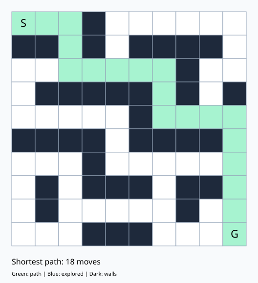

<div align="center">

# 🤖 RescueBot
### Intelligent Escape Route Finder Using A* Search

**Find the shortest route. Navigate obstacles. Visualize the solution.**


**Syntecxhub Internship · Artificial Intelligence · Week 1 · Project 1**

</div>

---

## 🌟 Overview

Imagine a rescue robot navigating blocked corridors to reach an emergency exit.

**RescueBot** demonstrates this scenario using **A* search**, finding a shortest path through a maze while avoiding walls. It includes console output, an SVG visualization, and automated correctness checks.

The rescue scenario is an educational simulation using a static grid.

## 🖼️ Solution Preview

<div align="center">



**Rescue maze: 18 moves from entrance to exit**

</div>

## ✨ Features

- 🧭 **Shortest-path search** using A* and Manhattan distance.
- 🧱 **Configurable mazes** defined in simple JSON files.
- 🚫 **Unreachable-goal detection** with a clear result.
- 🎨 **SVG visualization** showing the route, walls, and explored cells.
- 💻 **Console visualization** for quick inspection.
- ✅ **Input validation** for grid shape, cell values, and endpoints.
- 🧪 **Automated verification** against an independent BFS implementation.
- 📦 **No third-party dependencies** required.

## 🚀 Quick Start

### 1. Download the project

Clone the repository and enter its folder:

```bash
git clone https://github.com/yasmeenmh90-beep/Syntecxhub_Maze_Solver.git
cd Syntecxhub_Maze_Solver
```

Alternatively, download and extract the repository ZIP, then open Terminal inside the extracted folder.

### 2. Run the default maze

```bash
python3 maze_solver.py --svg solution.svg
```

### 3. Open the visualization

On macOS:

```bash
open solution.svg
```

On other systems, open the SVG file in a web browser.

> **Requirements:** Python 3.9 or newer. No package installation is needed.

## 🤖 Run the RescueBot Scenario

Navigate a larger **10 × 10 maze** from the entrance at `[0, 0]` to the exit at `[9, 9]`.

```bash
python3 maze_solver.py --maze rescue_maze.json --svg rescue_solution.svg
```

Open the result on macOS:

```bash
open rescue_solution.svg
```

### Verified Example Results

| Scenario | Result | Moves | Expanded cells |
|:--|:--|:--:|:--:|
| Default maze | Path found | 8 | 9 |
| RescueBot maze | Path found | 18 | 19 |
| Unreachable maze | No path found | — | 3 |

Expanded cells are cells removed from the search queue for processing, including the goal when reached.

## 🧱 Create Your Own Maze

Edit `maze.json` or create a new JSON file:

```json
{
  "grid": [
    [0, 0, 1],
    [1, 0, 1],
    [0, 0, 0]
  ],
  "start": [0, 0],
  "goal": [2, 2]
}
```

| Value | Meaning |
|:--:|:--|
| `0` | Open cell |
| `1` | Wall |
| `start` | Starting coordinate: `[row, column]` |
| `goal` | Destination coordinate: `[row, column]` |

Coordinates begin at **zero in the top-left corner**. The grid must be rectangular, and both endpoints must be open cells inside it.

Run your custom maze:

```bash
python3 maze_solver.py --maze maze.json --svg custom_solution.svg
```

## 🧠 How A* Works

Each open cell is a **node**. Connections between adjacent open cells form the graph’s **edges**.

The robot can move **up, down, left, or right**. Each move costs **1**.

A* prioritizes cells using:

```text
f(n) = g(n) + h(n)
```

| Term | Meaning |
|:--:|:--|
| `g(n)` | Best known distance from the start to the current cell |
| `h(n)` | Estimated distance from the current cell to the goal |
| `f(n)` | Estimated total distance through the current cell |

### Manhattan Distance

```python
h = abs(row - goal_row) + abs(column - goal_column)
```

Manhattan distance is admissible and consistent for this grid’s four-direction, unit-cost movement. This allows A* to return a shortest path.

### Search Process

1. Add the starting cell to a priority queue.
2. Select the cell with the smallest estimated total distance.
3. Examine its valid, walkable neighbors.
4. Update costs and parent links when a shorter route is found.
5. Reconstruct the route when the goal is reached.
6. Report an unreachable goal if the queue becomes empty.

The implementation uses Python’s `heapq` for the priority queue and skips outdated entries.

> A path includes both endpoints, so its move count is `len(path) - 1`. Multiple equally short routes may exist.

## 🎨 Visualization Guide

### SVG Colors

| Appearance | Meaning |
|:--|:--|
| 🟩 Green | Final shortest path |
| 🟦 Blue | Explored cells outside the final path |
| ⬛ Dark | Walls |
| ⬜ White | Open cells not expanded |

### Console Symbols

| Symbol | Meaning |
|:--:|:--|
| `S` | Start |
| `G` | Goal |
| `B` | Start and goal are the same cell |
| `#` | Wall |
| `*` | Final path |
| `.` | Explored cell outside the path |
| `-` | Open cell not expanded |

The visualization is a **static snapshot**. In examples where every expanded cell belongs to the final route, no blue cells appear.

## 🚫 Unreachable Goals

Run the blocked example:

```bash
python3 maze_solver.py --maze unreachable.json
```

Expected result:

```text
No path found: goal is unreachable.
```

An unreachable goal is a valid search outcome. Invalid input, such as a blocked endpoint or an irregular grid, produces an error.

## 🧪 Testing

Run the automated checks:

```bash
python3 -m unittest -v
```

The test suite covers:

| Check | What it verifies |
|:--|:--|
| Shortest paths | Compares A* with BFS on 100 seeded random mazes |
| Path validity | Checks endpoints, legal movement, and wall avoidance |
| Unreachable goal | Confirms no path is returned |
| Identical endpoints | Confirms a zero-move path |
| Invalid inputs | Rejects malformed grids and invalid endpoints |

**Verified locally: all 4 test methods passed.**

## 📁 Project Files

| File | Purpose |
|:--|:--|
| `maze_solver.py` | A* algorithm, CLI, and visualizations |
| `maze.json` | Default editable maze |
| `rescue_maze.json` | Larger RescueBot scenario |
| `unreachable.json` | Blocked-maze example |
| `test_maze_solver.py` | Automated correctness checks |
| `solution.svg` | Default maze visualization |
| `rescue_solution.svg` | RescueBot visualization |
| `.gitignore` | Excludes temporary and environment files |

## 🎓 Learning Outcomes

This project demonstrates:

- Modeling a grid as a graph.
- Implementing heuristic search.
- Using a priority queue.
- Reconstructing paths through parent links.
- Handling invalid inputs and unreachable states.
- Checking an algorithm against an independent baseline.

---

<div align="center">

**Developed by Yasmeen Azmat Ali**

*Syntecxhub Internship · Week 1 — Project 1*

</div>
